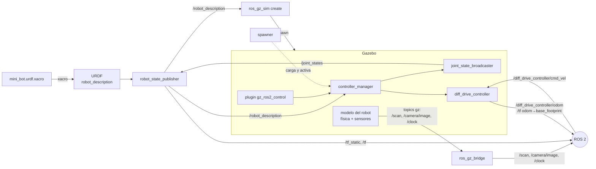

# Anatomía de un robot simulado

Qué piezas intervienen desde que se escribe un xacro hasta que el robot conduce en Gazebo, qué
hace cada una y cómo se hablan. Es el `sim.launch.py` completo (el del preámbulo 3), pieza a pieza.

Todo lo que dice "verificado" se ha comprobado con ese launch en marcha (`ros2 node list` y
`ros2 topic info -v`), en la imagen del taller.

## El mapa

Hay **dos mundos separados**: Gazebo, que tiene sus propios topics, y ROS 2. Solo hay tres
puertas entre ellos:

- **`create`**, que mete el robot en Gazebo.
- **`ros_gz_bridge`**, que copia topics de un lado al otro.
- **`gz_ros2_control`**, un plugin que vive dentro de Gazebo y habla ROS 2.

## Las piezas, en el orden en que entran

### 1. El xacro y el `robot_description`

- **Qué es.** `mini_bot.urdf.xacro` es el URDF con variables y macros. El comando `xacro` lo
  expande a URDF normal: un texto XML con links, joints, sensores y el bloque `<ros2_control>`.
- **Qué hace.** Nada por sí solo: es la descripción del robot. A ese texto ya expandido se le llama
  **`robot_description`**, y es la única fuente de verdad. Todas las piezas siguientes leen el mismo.
- **En el launch.** `Command(['xacro ', ..., ' namespace:=', ns, ' prefix:=', prefix])`. El xacro
  se expande al lanzar, así que los cambios se ven sin recompilar.
- **Dónde:** preámbulo 1 (geometría), preámbulo 2 (sensores) y preámbulo 3 (`<ros2_control>`).

### 2. `robot_state_publisher`

- **Qué es.** Un nodo de ROS 2. **No tiene nada que ver con Gazebo**: funciona igual con un robot
  real.
- **Qué hace.** Lee el `robot_description` como parámetro y hace dos cosas:
  - Lo **republica en el topic `/robot_description`**, para que otros lo lean sin tener el fichero.
  - Publica la **TF** del robot, es decir, dónde está cada link respecto a su padre:
    - Los joints fijos (`base_link`, `lidar_link`, `camera_link`, `caster_link`) en `/tf_static`,
      una vez.
    - Los joints que se mueven (las ruedas) en `/tf`, **pero solo si alguien le dice cuánto han
      girado**, en `/joint_states`.
- **Entra:** el parámetro `robot_description` y `/joint_states`. **Sale:** `/robot_description`,
  `/tf_static` y `/tf`. Verificado.
- **Dónde:** preámbulo 1, primero con RViz, sin Gazebo, y después con Gazebo.

### 3. Quién publica `/joint_states`: el *publisher* y el *broadcaster*

Se confunden siempre porque se llaman casi igual. Hacen lo mismo, publicar `/joint_states`, pero
sacan los valores de sitios distintos:

| | `joint_state_publisher_gui` | `joint_state_broadcaster` |
|---|---|---|
| Qué es | Un nodo con una ventana de sliders | Un controlador de ros2_control |
| De dónde saca los ángulos | De los sliders, que se mueven a mano | Del hardware: aquí, las ruedas de Gazebo |
| Dónde aparece | `display.launch.py`, preámbulo 1 | `sim.launch.py`, preámbulo 3 |
| Para qué | Comprobar la geometría sin simular | Que la TF de las ruedas siga al robot de verdad |

Desde que el robot entra en Gazebo (preámbulo 1) hasta el preámbulo 3 no hay ninguno de los
dos, así que las ruedas no tienen TF.

### 4. Gazebo y el mundo

- **Qué es.** El simulador: `gz sim` con un fichero de mundo (`workshop.sdf`).
- **Qué hace.** Física, colisiones y sensores. Los sensores solo funcionan si **el mundo** carga
  sus sistemas: `gz-sim-sensors-system` para LiDAR y cámara, `gz-sim-imu-system` para la IMU. Ya
  vienen en `workshop.sdf`.
- **En el launch.** `IncludeLaunchDescription` de `ros_gz_sim/gz_sim.launch.py`, con
  `gz_args = ['-r ', mundo]`. El `-r` arranca la simulación, que si no empieza en pausa.
- **Dónde:** preámbulo 1. Con la suite, el Model Importer.

### 5. `ros_gz_sim create`: el spawn

- **Qué es.** Un programa que se ejecuta **una vez y termina** (verificado: `process has finished
  cleanly`).
- **Qué hace.** Lee el `robot_description` desde el topic (`-topic robot_description`), se lo da
  a Gazebo, que lo convierte de URDF a SDF, y Gazebo crea el modelo en el mundo con el nombre
  `-name` y la pose `-x -y -z -Y`.
- **Lo que no hace:** nada en ROS 2. Después del spawn, el robot existe en Gazebo y en ROS 2 no
  aparece nada nuevo.
- **Dónde:** preámbulo 1. Con la suite, el Model Importer.

### 6. Los sensores: `<sensor>` dentro de `<gazebo>`

- **Qué es.** Un bloque del xacro que Gazebo entiende y ROS 2 ignora.
- **Qué hace.** Gazebo simula el LiDAR y la cámara y publica en **topics de Gazebo**, con el
  nombre de `<topic>`. `gz topic -l` los ve; `ros2 topic list` no.
- **`gz_frame_id`:** el `frame_id` que llevarán los mensajes, el link de la TF en el que hay que
  pintarlos.
- **Dónde:** preámbulo 2 y ejercicio 2.

### 7. `ros_gz_bridge`

- **Qué es.** El nodo `parameter_bridge`.
- **Qué hace.** Copia mensajes de un topic de Gazebo a uno de ROS 2, o al revés, **uno a uno y
  solo los que le pidas** en `bridge.yaml`, cada uno con su tipo de Gazebo y su tipo de ROS 2.
- **El que nunca debe faltar: `/clock`.** Es el reloj de la simulación. Todos los nodos con
  `use_sim_time: true` lo usan en vez de la hora del ordenador. Sin él, su reloj se queda en 0:
  la odometría sale con todas las marcas de tiempo a 0 y TF se queja (visto en la validación).
  Verificado: lo leen `robot_state_publisher`, `controller_manager` y los dos controladores.
- **Dónde:** preámbulo 2 y ejercicio 2. Con la suite, el Bridge Manager.

### 8. `gz_ros2_control`: el plugin y el `controller_manager`

Es la tercera puerta, y la que tiene más piezas.

- **El bloque `<ros2_control>` del xacro** dice qué joints controla el sistema y cómo:
  `command_interface` (lo que se le puede mandar, aquí la velocidad) y `state_interface` (lo que
  se puede leer, aquí posición y velocidad).
- **El plugin `gz_ros2_control-system`,** declarado en el xacro, se carga **dentro de Gazebo**
  cuando el robot aparece. Hace de hardware falso: lee las ruedas simuladas y les aplica las
  velocidades.
- **El `controller_manager`** lo arranca el plugin, y también vive dentro del proceso de Gazebo
  (verificado: no hay un proceso aparte). Lee `controllers.yaml` y gestiona los controladores.
  Necesita el URDF, así que lo lee del topic `/robot_description`. Por eso **sin
  `robot_state_publisher` la simulación se queda congelada** esperándolo (verificado).
- **Dónde:** preámbulo 3 y ejercicio 3. Con la suite, el Control Manager.

### 9. `spawner`

- **Qué es.** Un programa que se ejecuta una vez y termina, como `create` (verificado).
- **Qué hace.** Le pide al `controller_manager` que cargue, configure y active un controlador.
  Un spawner por controlador.
- **Si el `controller_manager` no existe todavía,** espera. Con la simulación en pausa, espera
  para siempre.

### 10. Los dos controladores

- **`joint_state_broadcaster`** lee los `state_interface` de las ruedas y publica
  `/joint_states`. Con eso, `robot_state_publisher` ya puede publicar la TF de las ruedas.
  No mueve nada.
- **`diff_drive_controller`** es el que conduce:
  - **Entra:** `/diff_drive_controller/cmd_vel` (`TwistStamped`, de ahí el `stamped:=true` del
    teleop).
  - **Hace:** convierte la velocidad del robot en velocidad de cada rueda, con
    `wheel_separation` y `wheel_radius` de `controllers.yaml`.
  - **Sale:** `/diff_drive_controller/odom` y la TF `odom → base_footprint`, verificado. Es lo
    que ancla el robot a un punto fijo en RViz.

### 11. RViz

- **Qué es.** Solo un visor. No publica nada del robot.
- **Qué hace.** Pinta el modelo (`RobotModel`, a partir de `/robot_description` y la TF), los scans
  y las imágenes. Todo se pinta respecto al **Fixed Frame**: `odom` para ver el robot moverse,
  `base_link` para verlo quieto.

## Quién publica qué

Verificado con el `sim.launch.py` completo en marcha, sin namespace:

| Topic | Lo publica | Lo leen |
|---|---|---|
| `/robot_description` | `robot_state_publisher` | `create`, `controller_manager`, RViz |
| `/joint_states` | `joint_state_broadcaster` | `robot_state_publisher` |
| `/tf_static` | `robot_state_publisher` (links fijos) | RViz y cualquier nodo con TF |
| `/tf` | `robot_state_publisher` (ruedas) y `diff_drive_controller` (`odom → base_footprint`) | RViz y cualquier nodo con TF |
| `/clock` | `ros_gz_bridge` | todos los nodos con `use_sim_time` |
| `/scan`, `/camera/image` | `ros_gz_bridge` | RViz |
| `/diff_drive_controller/cmd_vel` | el teleop | `diff_drive_controller` |
| `/diff_drive_controller/odom` | `diff_drive_controller` | RViz, navegación |

## Qué espera a qué

El launch lo arranca todo a la vez, pero cada pieza espera a la anterior:

1. `create` espera a que el mundo de Gazebo responda (lo reintenta cada pocos segundos) y a que
   `robot_state_publisher` publique `/robot_description` (verificado). En `sim.launch.py`,
   además, arranca con 3 s de retraso (`TimerAction`), para que el orden sea siempre el mismo.
2. El plugin de ros2_control nace con el robot. Su `controller_manager` espera también a
   `/robot_description`.
3. Los spawners esperan al `controller_manager`.
4. Los controladores solo se mueven si la simulación corre. Si está en pausa, pulsa ▶.

Cuando algo no aparezca, recorre esta lista de arriba abajo.

## Lo mismo con la suite

Cada panel sustituye a una parte del launch:

| Pieza del launch | Panel de la suite |
|---|---|
| `xacro` + `robot_state_publisher` + `create` | **Model Importer**: expande, enseña un preview, hace el spawn y lanza el `robot_state_publisher` |
| `ros_gz_bridge` + `bridge.yaml` | **Bridge Manager**: recorre el mundo, encuentra los sensores y lanza el puente |
| `spawner` | **ROS 2 Control Manager**: carga, configura y activa, y enseña el estado de cada controlador |

Lo que la suite **no** sustituye: el xacro, con su bloque `<ros2_control>` y sus sensores, y
`controllers.yaml`. Eso sigue siendo el robot.

## Y con varios robots

Tres nombres distintos, que se confunden siempre:

| | Ejemplo | Dónde vive | Para qué |
|---|---|---|---|
| Nombre del modelo | `robot_a` | Gazebo (`-name`) | Que Gazebo no tenga dos modelos con el mismo nombre |
| Namespace | `/robot_a` | ROS 2: nodos y topics | Que haya un `/robot_a/scan` y un `/robot_b/scan` |
| Prefijo de frames | `robot_a/` | TF: nombres de los links | Que en `/tf`, que es único para todos, no haya dos `base_link` |

El porqué de la barra en el prefijo está en el post-ejercicio 1.
